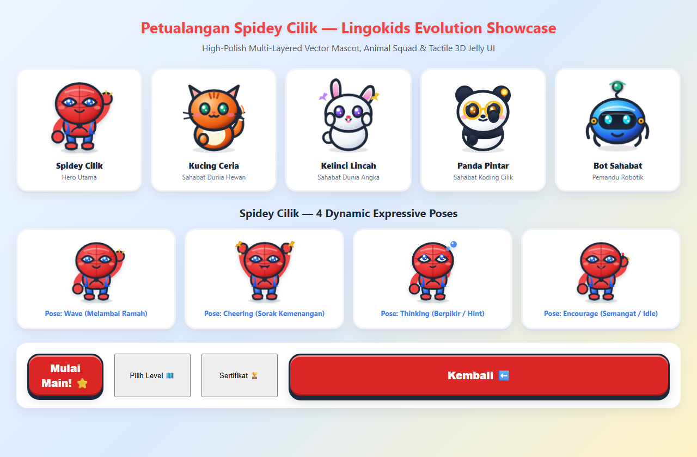

# 🕷️ Petualangan Spidey Cilik — Game Edukasi Balita

Game edukasi web ramah anak (usia 3–4 tahun) bertema petualangan Spidey Cilik dengan visual dan karakter bergaya **Lingokids**, kontrol sentuh taktil 3D Jelly, serta 100% offline tanpa dependensi eksternal.



## ✨ Fitur Unggulan

- **Lingokids Commercial Grade Mascot & Squad**:
  - Karakter Spidey Cilik dan 4 sahabat hewan (*Kucing Ceria*, *Kelinci Lincah*, *Panda Pintar*, *Bot Sahabat*).
  - Vektor SVG multi-lapis (*volumetric shading, rosy cheeks, anime chibi highlights*).
  - 4 pose ekspresif (*wave, cheer, think, encourage*) dengan animasi GPU 60fps.
- **Tactile 3D "Jelly" Preschool UI**:
  - Tombol 3D kenyal dengan efek pantulan lentur (*squishy spring recoil*).
  - Target sentuhan balita ekstra besar (min 64px – 80px).
  - Kontras ramah mata berstandar WCAG AA & AAA.
- **75 Level Edukatif di 4 Dunia**:
  - 🐾 **Hutan Satwa Lucu** (11 level)
  - 🔢 **Kota Angka Spidey** (22 level)
  - 🕸️ **Markas Pahlawan Cilik** (23 level)
  - 🤖 **Lab Robot & Koding** (19 level)
- **9 Mesin Mini-Game Interaktif**:
  - Hubungkan bayangan, labirin BFS, pilih jawaban, sambung titik, tebalkan pola, mewarnai, urutkan ukuran/angka, koding panah terprogram, dan kartu memori pasangan.
- **Audio Prosedural Ramah Anak**:
  - Sintesis nada Web Audio dual-harmonic (pop air, ketukan kayu, denting pentatonik, tanpa nada penalti yang membuat frustrasi).
- **Offline Progressive Web App (PWA)**:
  - Cache-first Service Worker, dapat diinstal dan dimainkan penuh tanpa koneksi internet.

## 🚀 Cara Menjalankan

Game ini dibuat dengan **Vanilla JavaScript, HTML5, dan CSS3 murni** tanpa bundler atau dependensi luar. Cukup jalankan local HTTP server:

```bash
# Menggunakan Python 3:
python -m http.server 8000

# Atau menggunakan Node.js (misal: serve / npx http-server):
npx serve .
```

Lalu buka peramban Anda di `http://localhost:8000`.

## 🧪 Verifikasi & Testing

Untuk menjalankan suite verifikasi otomatis:

```bash
node selfcheck.mjs
node test_task_verification.mjs
node tests/test_commercial_evolution.mjs
node test_e2e.mjs
```

---
Dibuat dengan ❤️ untuk pembelajaran balita mandiri & menyenangkan.
